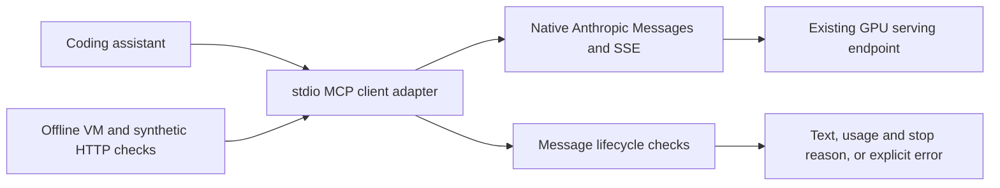

# System design and failure boundary

## Deployment context

The underlying project concerned GLM-5.2 serving on multi-node A100/H100
allocations. Relevant decisions included resource admission, tensor/pipeline
parallelism, precision and attention-kernel compatibility, token budgets,
native API compatibility, and cleanup after acceptance or failure.

This showcase extracts the client/validation component. It does not include
site topology, node identities, model data, cluster access or a deployment
controller. It cannot establish that a current allocation or service exists.

## Client boundaries

The calling assistant invokes a bounded secondary-model tool. The adapter
loads credentials from caller-provided environment/file configuration,
applies configurable output-token caps, and uses a configured endpoint/model
identity. The application remains responsible for its own tools and writable
workspace. Model access through MCP is distinct from an assistant's primary
model selection.

The source exposes a thinking boolean, not a complete per-model effort
directory. A declared flag or output cap is not proof of an endpoint's native
capabilities or available context. Long-context acceptance depends on the
actual model, tokenizer, runtime configuration and the combined input/output
budget.

## Concrete defect: false stream completion

The preserved baseline treated a successful HTTP response as completed even
when an SSE error arrived or the stream ended before `message_stop`. A caller
could therefore accept partial text as a successful result.

The selected candidate changes only `requestMessageStream`. It rejects
explicit SSE errors, missing terminal events, duplicate starts, lifecycle
events in invalid positions, and a terminal message without a stop reason.
An error follows the existing error-result path and does not return partial
output as a successful answer. Ping and unknown event types remain tolerated.

Endpoint selection, credential loading, retry/fallback behavior and runtime
configuration were not changed by this repair. This is a narrow lifecycle
repair rather than a complete streaming-protocol validator.

## Operational separation

Resource admission, model/container identity, scheduler execution, endpoint
acceptance and post-run cleanup are separate from client-source validation.
Historical deployment evidence and an offline client check cannot substitute
for a new live acceptance result.
